  <a href="#about"><b>About</b></a> &nbsp;·&nbsp;
  <a href="#alpha-group"><b>Alpha Group</b></a> &nbsp;·&nbsp;
  <a href="#journey"><b>Journey</b></a> &nbsp;·&nbsp;
  <a href="#expertise"><b>Expertise</b></a> &nbsp;·&nbsp;
  <a href="#stack"><b>Stack</b></a> &nbsp;·&nbsp;
  <a href="#projects"><b>Projects</b></a> &nbsp;·&nbsp;
  <a href="#achievements"><b>Achievements</b></a> &nbsp;·&nbsp;
  <a href="#teaching"><b>Teaching</b></a> &nbsp;·&nbsp;
  <a href="#analytics"><b>Analytics</b></a>

I'm **Aseef Ahmed** — *Sir Aseef* to my students — **Founder of Alpha Group**, a **Software Engineer and Data Scientist** from **Karachi, Pakistan**, working where engineering, enterprise and education meet.

- 🏢 **Founder, Alpha Group** — my own software house, focused on software development, data & AI solutions, and training.
- 🏛️ **Senior Manager Academics** at **Aptech Learning** — I oversee centre academics and operations and build faculty capacity through training.
- 💻 **Software Engineer & Scrum Master** at **Contour Software** — Node.js, Express, MongoDB, ASP.NET Core MVC (C#) and Python ML.
- 🔬 **MS Data Science** at **NED University of Engineering & Technology** — coursework complete, thesis in progress on climate-hazard forecasting.
- 🎓 **BS Software Engineering** from **Sir Syed University (SSUET)** on a full scholarship.
- 🧠 I work across **Data Science, Data Engineering, AI/ML, LLMs, RAG, Agentic & Generative AI**, and I can teach **any programming course, at any level**.
- 🎤 Trainer and motivational speaker — I lead a faculty team and supervise student eProjects in **PHP, MERN, Flutter, Big Data and AI**.

**🗣️ Languages** — specialised in Python, R, C# and JavaScript ES6+

**🧠 Data Science, AI & ML**

   

**🗄️ Data Engineering, Big Data & Databases**

  

**🌐 Full-Stack — MERN & .NET Core**

**📈 Analytics & BI**

   

**🧰 Tools**

 

  

<picture>
  <source media="(prefers-color-scheme: dark)" srcset="https://raw.githubusercontent.com/SirAseef/SirAseef/output/github-snake-dark.svg" />
  
</picture>

  

